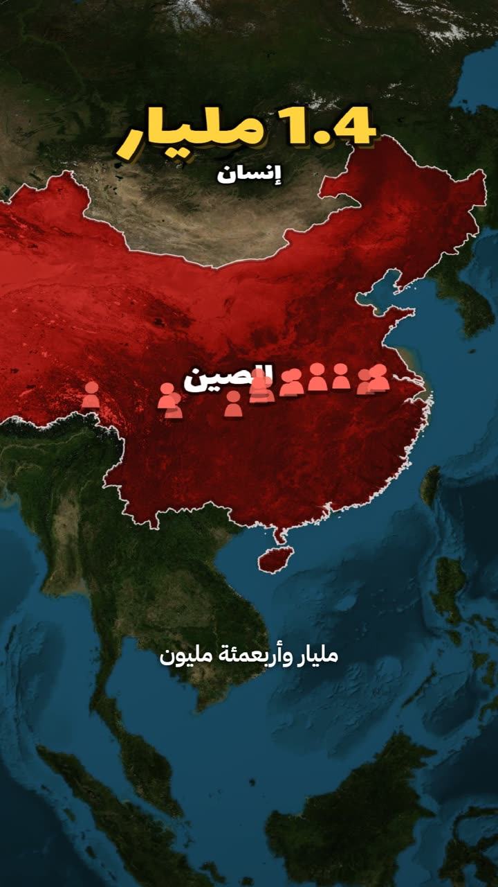

# iconMap

Make map-explainer videos with Arabic right-to-left text, from a short chat. iconMap greets you, asks five quick questions, and builds the whole video: a sourced script, a voice, the map, captions timed word by word, and sound effects.

**iconMap بلقن لكلود كود**: يسوي فيديوهات خرائط متحركة بالعربي. يرحّب فيك ويسألك 5 أسئلة سريعة (نوع الفيديو، فكرة من 5 يقترحها، طولي أو عرضي، الجمهور، الصوت) وبعدها يسوي الفيديو كامل.

## Proof: a video made with it
[](https://reemalfadly.github.io/iconmap/#proof)

A 33-second China vs USA comparison built with the five questions. Every number was read from an official page, listed with its quote in [`docs/media/china-usa-sources.md`](docs/media/china-usa-sources.md). Watch it on the [project page](https://reemalfadly.github.io/iconmap/#proof) or open [`docs/media/china-usa.mp4`](docs/media/china-usa.mp4). Voice generated with elevenlabs.io (free plan); imagery NASA Blue Marble via NASA GIBS; borders Natural Earth.

## What it makes
- **3D globe on real NASA satellite imagery** that dives from space to the place (vertical 1080x1920, 60 fps).
- **Flat map engine** for any size (vertical, horizontal, square), your own map images, tilt and orbit camera.
- Countries light up when the voice names them; rivers draw themselves in colour; size comparisons, measure arrows, routes that rise in an arc.
- **Moving numbers**: they run, drop, flip, roll like an odometer, and stand as 3D columns on the map.
- Captions timed word by word, Arabic place names for every country, sound effects always on.
- Voice: a free Arabic voice, **ElevenLabs** (your own account), or your own recording.
- Scripts with every number checked against a primary source, and a sources file.

## Install (Claude Code)
```
/plugin marketplace add reemalfadly/iconmap
/plugin install iconmap@iconmap
```
Then restart the session, open a folder for your video and type **`/iconmap`** (or just say "make me a map video"). First run: Node 18+, ffmpeg and Python 3.10+ are needed; run once:
```
powershell -ExecutionPolicy Bypass -File setup.ps1      # Windows
bash setup.sh                                           # macOS / Linux
```
The Globe engine needs a GPU with WebGL. Without one, the flat engine works on the CPU.

## What is inside
| skill | what it does |
|---|---|
| `iconMap` | greets you, asks the 5 questions in the chat, picks the engine, runs the others |
| `iconMap-script` | 5 ideas, then a short script with every number checked against a primary source |
| `iconMap-voice` | free Arabic voices, ElevenLabs, or your recording, with word timing |
| `iconMap-globe` | the 3D globe engine on NASA imagery |
| `iconMap-flat` | the flat engine: any size, your own images |
| `iconMap-check` | the final check before delivery |

Optional: a visual question page (`brief/`), a local page on your own computer, nothing is uploaded. Ask for it if you prefer clicking to chatting.

## ElevenLabs (natural voice)
Save your key once with `powershell -ExecutionPolicy Bypass -File scripts/set_key.ps1` (typed hidden, stored only on your computer), then pick a voice: `python scripts/eleven.py voices --language ar`. The text you voice is sent to ElevenLabs and uses your credits.

## Credits and data
Satellite imagery: NASA Blue Marble via NASA GIBS (the build prints the acknowledgement line for your video description). Borders and rivers: Natural Earth (public domain). Fonts: SIL Open Font License. Free voices: Microsoft Edge online voices (the text is sent to Microsoft). See `rights/`.

## Licence
**Free to use, not to resell.** Use iconMap and make videos with it for any purpose, commercial ones included; the videos are yours. You may not sell it, re-upload it or pass it off as your own. Full terms in [`LICENSE`](LICENSE).